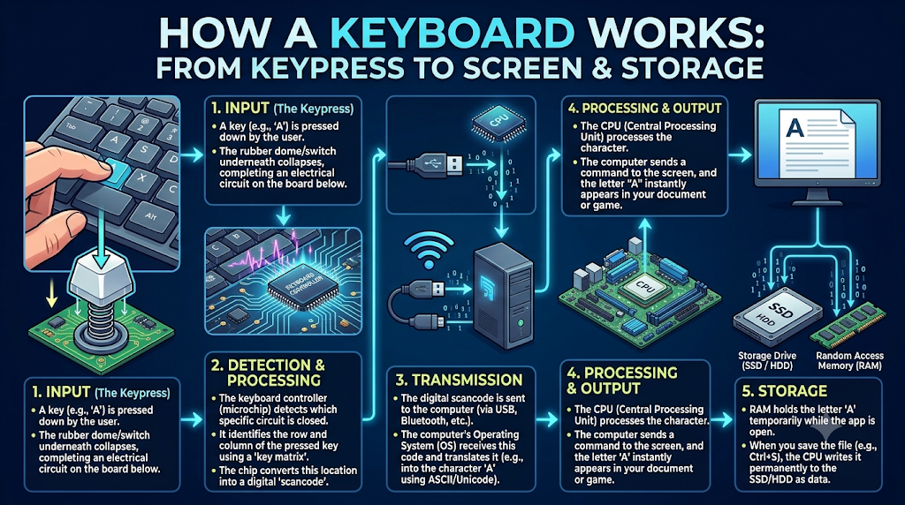

# Mission 1: Know Your Computer

## 1. Overview & Mission Objective
- **Assignment**: The Digital Detective — Diwali Independent Learning Assignment
- **Mission**: Mission 1 — Know your computer
- **Objective**: Explain how a computer system takes input, processes data, produces output, and stores information (the **IPOS** cycle). Classify fundamental hardware, operating system software, application software, and utility software. Identify and analyze dedicated embedded computer systems operating in everyday environments.
- **Privacy Standard**: In strict accordance with assignment guidelines, all system descriptions, diagnostics, and visual evidence omit personal usernames, machine serial numbers, local network IP addresses, and hardware MAC addresses. All usernames in captured process monitors have been redacted.

---

## 2. Task 1.1 — Trace One Activity Using the IPOS Cycle

### Chosen Activity: Typing, Formatting, and Saving a Source Code File in an Editor
The IPOS (Input, Processing, Output, Storage) model represents the fundamental pipeline through which all modern computers transform external physical interaction into persistent digital data.

### IPOS Activity Table

| Stage | What Happens in the Activity? | Hardware & Component Involved |
| :--- | :--- | :--- |
| **1. Input** | The user presses a key (e.g., `'a'`). The key switch closes an electrical circuit on the keyboard matrix. The keyboard controller detects the switch closure, generates an electrical scan code, and transmits it via USB/Bluetooth bus to the host controller. | Keyboard switch matrix, keyboard microcontroller, USB/Bluetooth interface bus. |
| **2. Processing** | The CPU receives an interrupt request from the keyboard bus. The OS kernel's keyboard driver decodes the scan code into an ASCII/Unicode character event and directs it to the active editor process. The CPU executes instructions to insert the character into the active document buffer loaded in volatile memory (RAM), while a syntax highlighting thread parses tokens. | Central Processing Unit (CPU: ALU, Control Unit, L1/L2/L3 caches), RAM (Random Access Memory), Memory Controller. |
| **3. Output** | The application requests a visual update. The Graphics Processing Unit (GPU) computes the glyph rasterization, anti-aliasing, and color styling, rendering the updated frame into the video framebuffer. The display controller streams the image buffer across an internal display interface (eDP/DisplayPort) to render the glyph on screen. | GPU (Graphics Processing Unit), Video Framebuffer, Retina/LCD/OLED Display Panel. |
| **4. Storage** | When the user triggers the Save command (`Cmd+S` or `Ctrl+S`), the application issues an asynchronous file write system call (`write()` and `fsync()`). The operating system's filesystem driver assigns disk blocks, updates filesystem metadata (inodes/directories), and the storage controller writes the data persistently into NAND flash cells. | NVMe Solid-State Drive (SSD) controller, NAND flash storage chips, non-volatile storage bus. |

### Visual Architecture: How a Keyboard Works (Input to Screen & Storage)
The diagram below illustrates the complete end-to-end IPOS execution flow from the mechanical key switch, microcontroller scan code detection, OS interrupt handling, CPU register processing, GPU rendering to screen, and persistent SSD storage serialization:

*Figure 1.1: Complete structural pipeline showing how an alphanumeric keypress moves from physical input through detection, bus transmission, CPU processing, screen output, and persistent storage.*

### Extended Architectural Explanation: End-to-End Data Flow
1. **Physical to Digital (Input Stage)**: Mechanical keypresses are converted to digital signals by the keyboard microcontroller. These signals trigger hardware interrupts (`IRQ`), pausing low-priority CPU tasks to ensure near-zero latency typing response.
2. **Volatile In-Memory Processing (Processing Stage)**: While the document is being edited, all modifications reside exclusively in **volatile RAM**. If power were lost at this point, unsaved characters in RAM would vanish. The CPU's arithmetic logic unit (ALU) and registers manage text buffers, cursor pointers, and line numbering.
3. **Visual Feedback Loop (Output Stage)**: Visual feedback occurs concurrently at 60 Hz or 120 Hz. The display pipeline ensures that the user receives immediate visual confirmation of each input before committing to storage.
4. **Persistent Serialization (Storage Stage)**: Saving bridges the volatile memory domain to non-volatile flash memory. The OS filesystem (such as APFS or ext4) flushes caches to disk blocks, ensuring data integrity across power cycles.

---

## 3. Task 1.2 — Identify and Classify Hardware and Software

Computer systems consist of a symbiotic relationship between physical components (**hardware**) and intangible instruction sets (**software**). Software is categorized based on its proximity to the hardware and its intended user role:
- **Operating System Software**: Manages hardware resources, processor scheduling, virtual memory, device drivers, and security isolation.
- **Application Software**: Directly serves end users by providing specific functional tools (browsing, authoring, programming).
- **Utility Software**: Diagnostic, maintenance, and administrative tools designed to safeguard, tune, and manage system resources.

### Hardware & Software Classification Table

| Item / Software Name | Hardware or Software? | Software Type (if applicable) | Purpose & Architectural Function |
| :--- | :--- | :--- | :--- |
| **Keyboard** | Hardware | *Not applicable* | Physical human input device that converts key depressions into digital scan codes. |
| **Central Processing Unit (CPU)** | Hardware | *Not applicable* | The core computation engine responsible for fetching, decoding, and executing machine instructions. |
| **Random Access Memory (RAM)** | Hardware | *Not applicable* | High-speed, volatile primary storage providing rapid read/write access for the OS kernel and running programs. |
| **NVMe Solid-State Drive (SSD)** | Hardware | *Not applicable* | Non-volatile secondary storage medium utilizing high-speed NAND flash chips for persistent data retention. |
| **Display Panel / Screen** | Hardware | *Not applicable* | Visual output hardware device that renders rasterized pixels generated by the graphics processing subsystem. |
| **macOS Darwin / Linux Kernel** | Software | Operating System Software | Core OS platform that manages CPU multitasking, memory allocation, hardware abstraction, and file systems. |
| **Visual Studio Code** | Software | Application Software | Extensible source code editor providing developers with text editing, debugging, syntax highlighting, and terminal tools. |
| **Web Browser (Chrome / Firefox)** | Software | Application Software | Interactive client application used to retrieve, parse, render HTML/CSS/JavaScript, and navigate web protocols. |
| **macOS Disk Utility** | Software | Utility Software | System management utility used to partition disks, repair file systems (First Aid), format storage drives, and verify integrity. |
| **Activity Monitor / Task Manager** | Software | Utility Software | System monitoring utility that tracks active processes, CPU utilization, thread counts, memory pressure, and energy impact. |

---

## 4. Task 1.3 — Computer Systems in Everyday Life

A **computer system** is not restricted to general-purpose desktop computers or smartphones. Embedded computing systems integrate microprocessors, specialized sensors, and actuators to perform dedicated automated functions throughout modern infrastructure.

### Everyday Embedded Computer Systems

| System | Main Purpose | One Primary Input | One Primary Output |
| :--- | :--- | :--- | :--- |
| **Automated Teller Machine (ATM)** | Delivers automated, secure banking operations (cash withdrawals, deposits, account balance queries) without human teller intervention. | Encrypted PIN pad / Chip card reader (detects account data and user security PIN). | High-precision motorized cash dispensing mechanism (or printed transaction receipt). |
| **Smart Traffic Light Controller** | Optimizes road intersection safety and vehicular flow by dynamically scheduling traffic signal intervals based on real-time traffic volume. | Inductive loop road sensors embedded in asphalt (detects electromagnetic disturbance caused by vehicles). | Multi-aspect high-intensity LED signal lanterns (Red, Amber, Green) and pedestrian walk displays. |
| **Metro Ticket Vending Machine (TVM)** | Automates passenger ticketing, token issuance, and contactless transit smart card recharges in rapid transit stations. | Capacitive touch-screen interface (receives user station destination selection). | RFID contactless smart token dispensing slot (ejects encoded travel token). |

### Technical Analysis of Everyday Systems
1. **ATM Architecture**: Combines a hardened real-time computer running specialized embedded OS software with high-security cryptographic peripherals (Hardware Security Modules, motorized shutters, deposit validators) connected via isolated internal buses.
2. **Traffic Signal Controller**: Employs an embedded microcomputer or programmable logic controller (PLC) running deterministic logic loops. When inductive road loops signal waiting queues, the CPU modifies phase transitions to relieve traffic congestion.
3. **Transit Ticket Machine**: Uses a specialized embedded PC running industrial touch drivers, cash/coin acceptors, and RFID reader/writers. Input from the touchscreen triggers pricing calculations that drive electromechanical token dispenser solenoids.

---

## 5. Tools & Commands Used
To inspect local system architecture and hardware details safely:
- `uname -a`: Verified OS kernel architecture.
- `python3 --version`: Verified high-level language runtime environment.
- `git --version`: Verified local version control utility.
- **Activity Monitor**: Inspected active thread dispatching, PID assignment, and volatile RAM pressure.
- **Disk Utility**: Verified APFS container partitioning, storage device hierarchy, and flash storage layout.

---

## 6. Reflections & Key Learnings
- **The IPOS Loop**: Understood that every computing task, no matter how complex (e.g., streaming video or machine learning), is an orchestration of the IPOS pipeline.
- **Volatile vs. Persistent Storage**: Learned why RAM and SSD storage serve fundamentally different roles: RAM provides fast nanosecond-level access for live execution, while SSD provides persistent storage across power resets.
- **Software Stratification**: Clarified the boundary between system software (which directly mediates hardware access) and application software (which relies on system APIs to accomplish user goals).

---

## 7. Difficulties Faced & Resolutions
- **Distinguishing Utility Software from System Software**: It is easy to confuse utilities (like Disk Utility or Activity Monitor) with the operating system itself. Resolved by recognizing that the operating system kernel is the core supervisor, whereas utility software consists of administrative programs running in user space to maintain and monitor the system.
- **Privacy-Safe Evidence Collection**: Standard system utility views display machine usernames and snapshot identifiers. Resolved by applying non-destructive Gaussian blurring to sensitive user columns and snapshot UUID fields before staging to version control.

---

## 8. Visual Verification Evidence Artifacts

The following visual artifacts corroborate the findings and classifications established in Mission 1:

### Evidence 1: IPOS End-to-End Keypress Architecture
Detailed pipeline illustrating electrical contact input, microcontroller scancode generation, operating system interrupt conversion, CPU scheduling, GPU display output, and SSD storage.

---

### Evidence 2: Utility Software & Volatile Memory Management (Activity Monitor)
Demonstrating real-time CPU task scheduling and volatile RAM distribution (16.00 GB physical RAM, 11.73 GB active memory load, process hierarchy, and thread allocation) captured via Activity Monitor. *Note: The user column has been blurred to protect personal system identity.*

---

### Evidence 3: Utility Software & Persistent Storage Management (Disk Utility)
Demonstrating secondary non-volatile storage architecture, showing the internal SSD Apple Fabric bus, APFS container allocation (994.61 GB capacity), and persistent read-only system snapshots. *Note: Snapshot UUID has been blurred for privacy compliance.*

