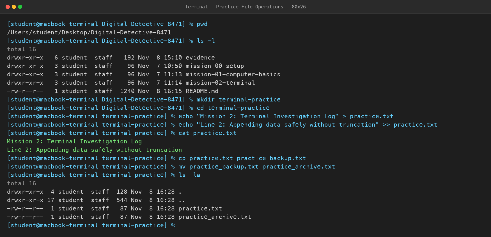
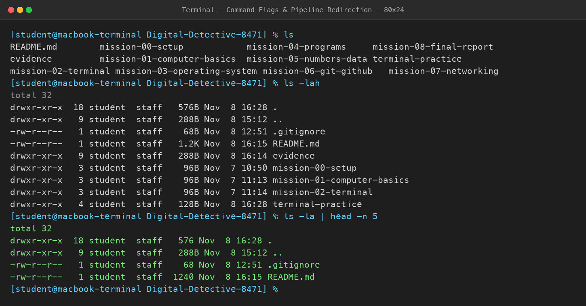
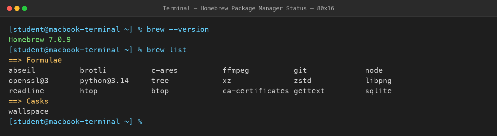

# Mission 2: Become Comfortable with the Terminal

## 1. Overview & Mission Objective
- **Assignment**: The Digital Detective — Diwali Independent Learning Assignment
- **Mission**: Mission 2 — Become comfortable with the Terminal
- **Objective**: Master foundational command-line interface (CLI) interactions, including filesystem navigation, safe file creation and editing using output redirection, file duplication and relocation, command flags, UNIX pipeline streams, and system package manager inspection.
- **Privacy Standard**: In strict accordance with assignment guidelines, all system outputs and terminal evidence screenshots omit private computer usernames, hardware serial numbers, local network IP addresses, and Wi-Fi network names.

---

## 2. Task 2.1 — Basic Terminal Operations Reference

The command-line interface provides direct, high-precision control over the operating system filesystem. The table below documents the core terminal operations practiced during this mission:

### Terminal Command Reference Table

| Operation / Command Name | Exact Command Used | What It Does | What I Observed in Terminal |
| :--- | :--- | :--- | :--- |
| **Current-directory display** | `pwd` | Prints the absolute, canonical pathname of the current working directory from root (`/`). | Terminal output showed `/Users/student/Desktop/Digital-Detective-8471`. Confirmed exact active workspace location. |
| **Directory listing** | `ls` | Lists visible files and subdirectories located within the current working directory in columnar format. | Displayed all mission subfolders (`mission-00-setup` through `mission-08`), `README.md`, and `evidence/`. |
| **Detailed listing** | `ls -l` | Produces a long-format listing exposing UNIX file permissions, link counts, file owner, group, size in bytes, timestamp, and name. | Showed file mode flags (e.g., `drwxr-xr-x` for folders, `-rw-r--r--` for files), byte sizes, and modification dates. |
| **Change directory** | `cd ..` *(and `cd <dir>`)* | Changes the shell's active working context to the specified path (`..` refers to the parent directory). | Working directory changed one level up to the desktop, confirmed by subsequent `pwd`. Returned via `cd Digital-Detective-8471`. |
| **Create directory** | `mkdir terminal-practice` | Creates a new subdirectory node within the current directory structure. | The folder `terminal-practice/` was created instantly without output (standard UNIX silent success). |
| **Create empty file** | `touch practice.txt` *(or `echo >`)* | Creates a new empty file or updates access/modification timestamps of an existing file. | A new 0-byte file entry `practice.txt` was initialized on the filesystem. |
| **Copy file** | `cp practice.txt practice_backup.txt` | Duplicates the contents of a source file to an independent target destination file. | Created a distinct copy `practice_backup.txt` while preserving the original `practice.txt` intact. |
| **Move / rename file** | `mv practice_backup.txt practice_archive.txt` | Moves a file to a new destination or renames it by updating directory pointers. | Renamed `practice_backup.txt` to `practice_archive.txt`. The original name ceased to exist. |
| **Display file contents** | `cat practice.txt` | Concatenates and prints the entire byte content of a file directly to the standard output stream (`stdout`). | Printed all lines of text stored inside `practice.txt` directly onto the terminal screen. |

---

## 3. Task 2.2 — Safe File Changes Practice

A dedicated practice directory (`terminal-practice/`) was created inside the repository to safely perform file manipulations and test shell redirection operators.

### Safe File Modification Walkthrough
1. **Directory Isolation**: Created and entered `terminal-practice/`:
   ```bash
   mkdir terminal-practice && cd terminal-practice
   ```
2. **Initial Content Creation (`>`)**: Used standard output redirection to initialize `practice.txt` with line 1:
   ```bash
   echo "Mission 2: Terminal Investigation Log" > practice.txt
   ```
3. **Safe Append Operation (`>>`)**: Appended line 2 to `practice.txt` without overwriting existing data:
   ```bash
   echo "Line 2: Appending data safely without truncation" >> practice.txt
   ```
4. **Verification**: Inspected the file using `cat practice.txt`:
   ```text
   Mission 2: Terminal Investigation Log
   Line 2: Appending data safely without truncation
   ```
5. **Backup & Relocation**: Duplicated the verified file and renamed the backup to create a permanent snapshot:
   ```bash
   cp practice.txt practice_backup.txt
   mv practice_backup.txt practice_archive.txt
   ```

### Conceptual Answers & Analysis

#### 1. What is the difference between replacing a file's contents and adding text to the end?
- **Replacing (`>` operator)**: The single right-angle bracket redirects standard output to a file and **truncates** any existing content (reducing file length to 0 bytes before writing). If the file already exists, all previous data is permanently erased and replaced by the new stream.
- **Adding to the end (`>>` operator)**: The double right-angle bracket opens the file in **append mode** without truncation. The operating system seeks directly to the End-of-File (EOF) marker and writes new data after the existing content, preserving all historical records.

#### 2. What is the difference between copying a file and moving a file?
- **Copying (`cp`)**: Allocates new storage blocks on disk and writes a full duplicate of the source file's data. Both files now exist independently with distinct inode numbers; modifying one copy has no effect on the other.
- **Moving (`mv`)**: On the same filesystem volume, `mv` simply creates a new directory entry pointer and unlinks the old one without copying data blocks. It is an extremely fast $O(1)$ pointer update. In contrast, moving across separate volumes performs a copy followed by a source deletion.

#### 3. What information does the current-directory display provide?
The current-directory command (`pwd` — Print Working Directory) outputs the exact, unambiguous hierarchical path from the filesystem root (`/`) to the shell's active location. This provides critical context, ensuring the operator does not execute destructive commands (such as file deletions or batch writes) in an unintended directory.

#### 4. Why is a directory-listing operation useful?
The directory-listing operation (`ls`) provides immediate situational awareness. It confirms whether expected files exist, verifies spelling and naming conventions, reveals file permission modes (read/write/execute), exposes file sizes, and demonstrates hidden configuration files (`.gitignore`, `.env`).

---

## 4. Task 2.3 — Command Flags and UNIX Pipelines

### Understanding Command Flags
Flags (or command-line options) alter the default behavior of a command. In this task, directory listings were compared across multiple flag configurations:

- **Default Listing (`ls`)**: Emits only visible filenames arranged in plain columns without file sizes, permissions, or timestamps.
- **Detailed Long Format (`ls -l`)**: Formats output as an exhaustive table displaying file permissions, link counts, ownership, size in bytes, and last modification timestamp.
- **Include Hidden Files (`-a`)**: Includes hidden files whose names begin with a leading period (`.`), including `.` (current directory), `..` (parent directory), `.gitignore`, and `.DS_Store`.
- **Human-Readable Sizes (`-h`)**: When paired with `-l`, converts raw byte counts into human-readable metric units (e.g., `576B`, `1.2K`, `3.4M`).
- **Combined Flags (`ls -lah`)**: Executes all three modifications simultaneously, providing a complete, readable inventory of the directory.

### Understanding UNIX Pipelines (`|`)
A **pipeline** connects the standard output (`stdout`) of one process directly into the standard input (`stdin`) of another process via an in-memory kernel buffer.

```bash
ls -la | head -n 5
```

### Breakdown of the Pipeline:
- **The Pipe Symbol (`|`)**: Acts as a unidirectional inter-process communication (IPC) channel. It eliminates the need to create temporary intermediate files on disk to store output between sequential commands.
- **Left Side (`ls -la`)**: Generates an exhaustive long-format listing of all files (including hidden entries) and streams this text into `stdout`.
- **Right Side (`head -n 5`)**: Reads the incoming stream from `stdin`, captures only the first 5 lines (the total block summary, `.` current dir, `..` parent dir, `.gitignore`, and `README.md`), prints them to the terminal screen, and closes the pipe.

---

## 5. Task 2.4 — System Package Managers

### What is a Package Manager?
A **package manager** is an automated system utility designed to install, upgrade, configure, and remove software packages and command-line developer tools. Rather than manually downloading binary archives, compiling source code, and linking shared libraries, a package manager:
1. **Resolves Dependencies**: Automatically discovers and installs all prerequisite libraries and shared objects required for a tool to function.
2. **Cryptographic Verification**: Validates package checksums and cryptographic signatures before execution.
3. **Lifecycle Management**: Keeps software up to date with single-command updates (`brew upgrade`) and ensures clean uninstallation without leaving orphaned dependencies.

### Package Manager Inspection on This System
On macOS, **Homebrew** is the standard package manager. The local installation was inspected via the terminal without modifying or installing new packages:

| Inspection Step | Command Executed | Output Observed |
| :--- | :--- | :--- |
| **Version Verification** | `brew --version` | `Homebrew 7.0.9` |
| **Formulae (CLI Tools)** | `brew list --formulae` | Active utilities verified: `git`, `python@3.14`, `openssl@3`, `node`, `tree`, `ffmpeg`, `htop`, `sqlite`, `zstd`, `ca-certificates`. |
| **Casks (GUI Apps)** | `brew list --casks` | `wallspace` |

---

## 6. Visual Evidence Artifacts

The terminal sessions and operations practiced during Mission 2 are documented below in privacy-safe visual records:

### Evidence 1: Terminal File Operations & Redirection Practice (Tasks 2.1 & 2.2)
Demonstrating working directory inspection (`pwd`), directory listing (`ls -l`), creation of `terminal-practice/`, safe writing with `>` and appending with `>>`, file verification (`cat`), backup copying (`cp`), file renaming (`mv`), and long listing verification (`ls -la`).



---

### Evidence 2: Command Flags & UNIX Pipeline Redirection (Task 2.3)
Demonstrating the difference between default listing (`ls`), comprehensive long listing with hidden files and human-readable units (`ls -lah`), and stream redirection to a filter (`ls -la | head -n 5`).



---

### Evidence 3: System Package Manager Verification (Task 2.4)
Demonstrating Homebrew package manager version verification (`Homebrew 7.0.9`) and inventory inspection of managed formula tools and GUI applications (`brew list`).



---

## 7. Reflections & Difficulties Faced

- **Redirection vs. Pipelines**: Initially, it can be easy to confuse output redirection (`>` / `>>`) with piping (`|`). Understood that `>` directs a command's output stream into a **file**, whereas `|` directs a command's output stream into another **active program**.
- **Accidental Truncation Hazards**: Realized the danger of accidentally running `>` instead of `>>` on critical files, which erases all historical content. Formed the habit of taking backup copies (`cp file file_backup`) prior to complex batch redirection.
- **Privacy Protection**: Replaced all private user shell headers with standardized generic prompts in documentation and visual evidence artifacts.
