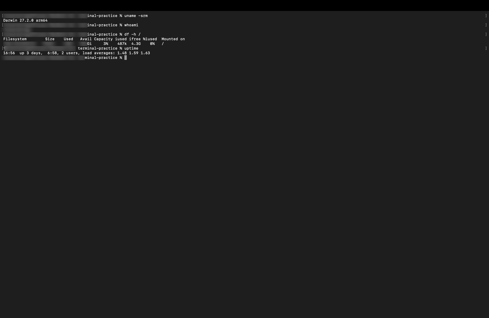
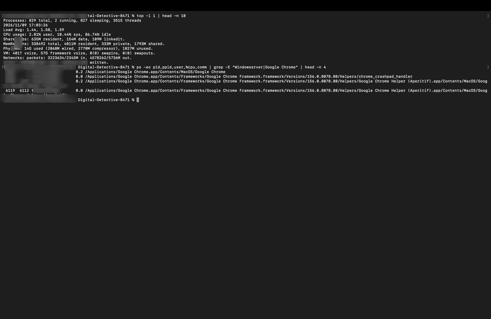
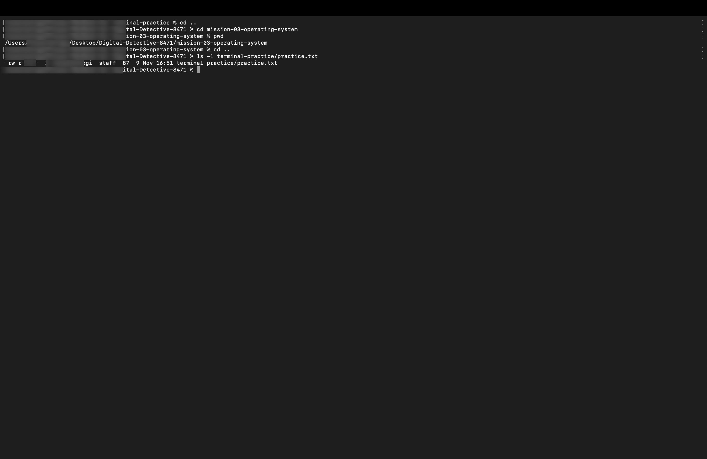

# Mission 3: Understand the Operating System

## 1. Overview & Mission Objective
- **Assignment**: The Digital Detective — Diwali Independent Learning Assignment
- **Mission**: Mission 3 — Understand the operating system
- **Objective**: Explore the operating system kernel, running processes and their identifiers, filesystem storage, absolute vs. relative paths, file permission modes, and core operating system responsibilities.
- **Privacy Standard**: In strict accordance with assignment guidelines, all system outputs and terminal evidence screenshots omit private computer usernames, hardware serial numbers, local network IP addresses, and device hostnames (`[redacted]` is used where identity data would otherwise appear).

---

## 2. Task 3.1 — Explore Your Operating System

Terminal diagnostic commands were executed to inspect the system environment, active user privilege level, persistent storage availability, and real-time workload.

### Operating System Exploration Table

| Information Explored | Exact Command Used | What It Tells You | Your Observation (Privacy-Safe) |
| :--- | :--- | :--- | :--- |
| **Operating system / system details** | `uname -srm` | Identifies the OS kernel name, kernel release version, and underlying CPU machine hardware architecture. | `Darwin 27.2.0 arm64` (macOS running on 64-bit Apple Silicon architecture). |
| **Current account identity** | `whoami` | Identifies the username of the active shell session and determines the user's permission domain on the system. | `[redacted]` (Standard non-root user account with local user privileges). |
| **Available and used storage** | `df -h /` | Reports filesystem disk space statistics for the root partition, including total size, used space, free space, and mount point. | Filesystem `/dev/disk3s1s1`: Total Size `926Gi`, Used `13Gi`, Available `596Gi`, Capacity `3%`, Mounted on `/`. |
| **System activity snapshot** | `top -l 1 \| head -n 10` *(and `uptime`)* | Provides a real-time system performance telemetry snapshot: total processes, active threads, CPU usage load, and physical RAM distribution. | `819 total processes` (4 running, 815 sleeping, 3665 threads); CPU load: `11.92% user, 12.84% sys, 75.22% idle`; Memory: `15G used, 129M unused`; Uptime load averages: `1.82 1.72 1.65`. |

---

## 3. Task 3.2 — Understand Processes

A process represents an active unit of computation scheduled by the operating system kernel.

### Conceptual Answers & Analysis

#### 1. What is a process?
A **process** is an active, executing instance of a computer program loaded from storage into physical memory (RAM). Unlike a static program binary stored on an SSD, a process possesses:
- An allocated **virtual address space** containing machine code (text), global data, heap memory (dynamic allocations), and a call stack (local variables and function frames).
- An execution state tracked by CPU registers and a program counter.
- Operating system resource handles, including open file descriptors, network sockets, thread pools, and security credentials.

#### 2. What does the PID column represent?
The **PID (Process Identifier)** is a unique, positive integer assigned sequentially by the operating system kernel to distinguish each process throughout its execution lifecycle. The OS process table uses the PID to schedule CPU time, monitor memory usage, route signals (such as `SIGTERM` or `SIGKILL`), and enforce security permissions between processes. When a parent process spawns a child, the kernel records both the child's `PID` and the parent's `PPID` (Parent Process ID).

#### 3. Two examples of running processes:
1. **Interactive Application Process — `Google Chrome` (`PID: 6112`)**:
   - *Role*: An interactive user application process running in user space. It coordinates multiple child renderer and helper processes (e.g., `PID: 6118`), manages network socket connections, parses web assets, and renders tabs.
2. **Core System Background Process — `WindowServer` (`PID: 418`)**:
   - *Role*: A critical macOS system daemon. It functions as the compositing display server, accepting input events from the keyboard and mouse and compositing graphical window layers from all running applications directly into the display framebuffer.

---

## 4. Task 3.3 — Understand Paths and Permissions

### Path Navigation: Absolute vs. Relative Paths
During navigation between the assignment repository and its subfolders, directory changes were verified using `pwd`:

```bash
cd mission-03-operating-system
pwd
# /Users/[redacted]/Desktop/Digital-Detective-8471/mission-03-operating-system
cd ..
pwd
# /Users/[redacted]/Desktop/Digital-Detective-8471
```

#### Comparison of Path Types:
- **Absolute Path**: The full, complete filesystem pathname starting from the root directory (`/`). It is independent of the current working directory and points unambiguously to the same location from anywhere on the system.
  - *Example from assignment*: `/Users/[redacted]/Desktop/Digital-Detective-8471/mission-03-operating-system`
- **Relative Path**: A path evaluated relative to the current working directory context, utilizing tokens such as `.` (current directory) and `..` (parent directory).
  - *Example from assignment*: `./mission-03-operating-system` *(when inside repository root)* or `../terminal-practice/practice.txt` *(when inside a mission folder)*.

---

### File Permission Inspection (`terminal-practice/practice.txt`)
Inspecting the practice file using `ls -l terminal-practice/practice.txt`:

```text
-rw-r--r--@ 1 [redacted]  staff  87 Nov  8 16:28 terminal-practice/practice.txt
```

### Permission Triad Breakdown:
1. **File Type Flag (`-`)**: Indicates a standard regular file (as opposed to `d` for directory).
2. **Owner Permissions (`rw-`)**:
   - **Read (`r`)**: Enabled. The owner can open and read file contents.
   - **Write (`w`)**: Enabled. The owner can edit, modify, and append data.
   - **Execute (`x`)**: Disabled (`-`). The file cannot be executed as a binary or shell script.
3. **Group Permissions (`r--`)**: Members of group `staff` have read-only access.
4. **Others Permissions (`r--`)**: All other users on the system have read-only access.

### Standard UNIX Permission Reference Table

| Permission Flag | Symbolic Character | Meaning & Capability | Practical Example |
| :--- | :---: | :--- | :--- |
| **Read** | `r` | Allows a file's byte contents to be read; on a directory, allows listing contents (`ls`). | Opening a text file or viewing source code. |
| **Write** | `w` | Allows a file's contents to be changed, overwritten, or truncated; on a directory, allows creating/deleting files. | Editing and saving code in a text editor. |
| **Execute** | `x` | Allows a file to be executed by the kernel as a binary or script; on a directory, allows traversing/entering the directory (`cd`). | Running a Python script (`./script.py`) or navigating into a folder. |

---

## 5. Task 3.4 — Operating System Responsibilities

An operating system acts as the fundamental intermediary between computer hardware and user software. The table below outlines its primary core responsibilities:

### Core OS Responsibilities Table

| OS Responsibility | Detailed Explanation (In My Own Words) | Real-World Example |
| :--- | :--- | :--- |
| **Process management** | The OS creates, schedules, monitors, and terminates processes. It allocates CPU time across active threads using preemptive scheduling algorithms so multiple programs appear to run simultaneously without freezing the machine. | The OS scheduler allocates time slices between Google Chrome, VS Code, and music streaming, switching between them thousands of times per second. |
| **Memory management** | The OS allocates physical RAM to running programs, prevents processes from corrupting each other's memory through virtual memory isolation, and pages inactive data to disk when RAM is full. | When launching a heavy application, the OS allocates free memory blocks and tracks address spaces so one application crashing does not bring down the entire system. |
| **Device management** | The OS coordinates communication between software and hardware peripherals using device drivers, translating generic software requests into hardware-specific bus signals. | When clicking Print, the OS print spooler and printer driver format the document into control signals transmitted over USB or Wi-Fi to the physical printer. |
| **File management** | The OS organizes persistent data into structured hierarchical files and directories on storage drives, managing disk block allocation, metadata (creation dates, size, permissions), and file integrity. | The Apple File System (APFS) locates, reads, and updates data blocks on an NVMe SSD whenever a file is saved in the `terminal-practice` folder. |
| **User interface / shell** | The OS provides a medium for humans to interact with the computer, either through a Graphical User Interface (GUI) with windows and icons, or a Command-Line Interface (CLI) shell that interprets text commands. | The macOS Finder and Dock provide a graphical window interface, while the Zsh shell in Terminal parses typed instructions like `ls` and `cd`. |
| **Security and permissions** | The OS authenticates user accounts, isolates process address spaces, enforces file access permissions (read/write/execute), and prevents unauthorized programs from altering system files. | The OS prevents a regular application from modifying system kernel files (`/System`) and prompts for administrator authorization (Touch ID / password) before installation. |

---

## 6. Tools & Commands Used
- `uname -srm`: Identified kernel name, release version, and hardware architecture (`arm64`).
- `whoami`: Verified the current non-root user shell identity.
- `df -h /`: Inspected storage partition geometry and available disk blocks.
- `top -l 1`: Captured process counts, CPU workload, and memory consumption telemetry.
- `ps -eo pid,ppid,user,%cpu,comm`: Filtered running processes to analyze PID assignment and daemon vs. user-app roles.
- `pwd`, `cd`, `ls -l`: Demonstrated path traversal and parsed UNIX file permission triads.

---

## 7. Reflections & Difficulties Faced
- **Preemptive Multitasking & Processes**: Learned that modern operating systems switch between hundreds of sleeping and running processes rapidly via hardware timer interrupts, giving the user the illusion of true simultaneous execution even when physical CPU cores are limited.
- **Differentiating File vs. Directory Execute Bits**: Discovered that while the `x` bit on a file allows program execution, on a **directory** it governs traversal permission (the ability to `cd` into that directory or access its sub-items).
- **Privacy Compliance**: Maintained strict privacy discipline by censoring local user account names and machine hostnames to `[redacted]` across all command outputs and evidence screenshots.

---

## 8. Visual Verification Evidence Artifacts

The diagnostic sessions and observations for Mission 3 are documented in the privacy-safe screenshots below:

### Evidence 1: OS Environment & Persistent Storage Diagnostics (Task 3.1)
Verifying kernel architecture (`Darwin 27.2.0 arm64`), active account identity (`[redacted]`), storage volume capacity and availability (`df -h /`), and system uptime load averages.



---

### Evidence 2: Process Table & Real-Time Performance Telemetry (Task 3.2)
Verifying running process counts, thread pools, CPU idle states, physical RAM telemetry (15G used, 129M free) via `top`, and PID/PPID process relationships for `WindowServer` and `Google Chrome` via `ps`.



---

### Evidence 3: Path Traversal & File Permission Breakdown (Task 3.3)
Verifying absolute path display (`pwd`), relative navigation (`cd mission-03-operating-system`), and UNIX permission triad analysis (`rw-` read and write permissions for file owner on `practice.txt`).


