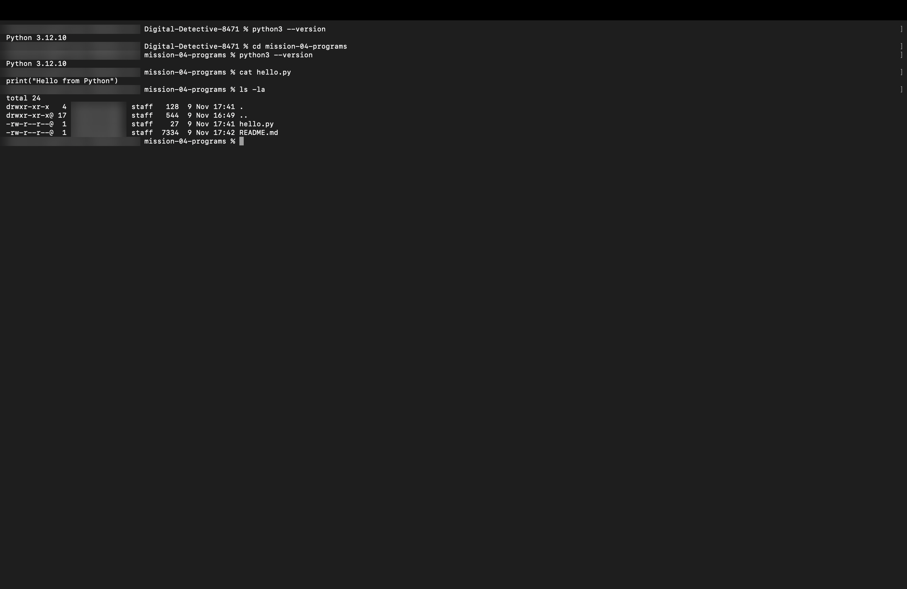

# Mission 4: How Programs Run — Compilers vs. Interpreters

## 1. Overview & Mission Objective
- **Assignment**: The Digital Detective — Diwali Independent Learning Assignment
- **Mission**: Mission 4 — How programs run
- **Objective**: Author and execute a simple Python program using the command line, and investigate how compilers and interpreters translate human-readable source code into CPU-executable instructions.
- **Privacy Standard**: In strict adherence to assignment guidelines, all system paths and command snippets omit personal usernames, machine serial numbers, and local network identities (`[redacted]` is used where identity data would otherwise appear).

---

## 2. Task 4.1 — Create and Run a Python Program (`hello.py`)

### Program Creation
A one-line Python script was created inside this mission folder (`mission-04-programs/hello.py`):

```python
print("Hello from Python")
```

### Execution via Command Line
The script was executed using the macOS Terminal with Python 3:

```bash
# Verify Python 3 installation version
python3 --version
# Output: Python 3.12.10

# Display file contents
cat hello.py
# Output: print("Hello from Python")

# Run the program through the Python 3 interpreter
python3 hello.py
# Output: Hello from Python
```

### Observation & Output Confirmation
Upon executing `python3 hello.py`, the Python interpreter initialized the runtime environment, parsed the syntax of `hello.py`, converted the instruction into intermediate bytecode, and passed it to the Python Virtual Machine (PVM) for immediate execution. The text string `Hello from Python` was successfully streamed to standard output (`stdout`) in the terminal.

---

## 3. Task 4.2 — Compare Compiler and Interpreter

### Comparison Table

| Comparison Point | Compiler | Interpreter |
| :--- | :--- | :--- |
| **When translation / execution happens** | **Ahead-of-Time (AOT)**: The compiler scans, analyzes, and translates the entire source code file into machine code or intermediate binary *before* execution begins in a dedicated compilation phase. | **Just-in-Time / At Runtime**: The interpreter reads, analyzes, translates, and executes source code (or bytecode) line-by-line (instruction-by-instruction) *while* the program is running. |
| **Typical output** | A standalone executable binary file (e.g., `.exe` on Windows, Mach-O on macOS, ELF on Linux) or compiled bytecode that runs directly on hardware without requiring source code. | Immediate execution results, side effects, and standard output (`stdout`) on screen. No standalone machine code binary is produced on disk. |
| **One practical example** | `clang` / `gcc` (for C and C++), `rustc` (for Rust), or `go build` (for Go). | `python3` (CPython interpreter), Node.js / V8 (for JavaScript), or `bash` / `zsh` (for shell scripts). |
| **One key advantage** | **Maximum Execution Speed & Hardware Efficiency**: Because translation and code optimization occur prior to runtime, the resulting binary executes directly on the CPU without runtime interpretation overhead, and all syntax/type errors are caught before deployment. | **Rapid Prototyping & Platform Portability**: Developers can immediately test and modify source code without waiting for lengthy build/compilation steps. Programs run unmodified across diverse operating systems as long as the interpreter is installed. |

---

### Core Conceptual Differences (In My Own Words)

A **compiler** translates an entire software program from human-readable high-level source code directly into machine-executable binary code before the user ever runs it. Because translation happens entirely ahead of time, compiled binaries run at maximum speed directly on the CPU, but any code modification requires recompiling the complete program.

In contrast, an **interpreter** analyzes and executes the source code instruction-by-instruction on the fly at runtime without producing an independent machine-code binary file. This makes interpreted programs exceptionally flexible and fast to debug during development, although they typically execute slower than compiled equivalents due to runtime parsing overhead.

While compilers prioritize raw runtime execution performance and early static syntax validation, interpreters prioritize developer agility, cross-platform portability, and dynamic runtime evaluation.

---

## 4. Understanding Modern Program Execution (The Python Hybrid Model)

Although Python is frequently categorized as an "interpreted language," modern CPython actually employs a **hybrid two-stage execution architecture**:

1. **Compilation Phase**:
   - When `python3 hello.py` is invoked, the CPython compiler first parses the Python source code and compiles it into low-level, platform-independent intermediate instructions known as **Python Bytecode** (often cached as `.pyc` files in `__pycache__`).
2. **Interpretation Phase**:
   - The compiled bytecode is then handed off to the **Python Virtual Machine (PVM)**, an execution engine/interpreter written in C that evaluates the bytecode instructions sequentially and translates them into host CPU instructions.

This hybrid approach allows Python to achieve fast startup times by caching compiled bytecode while maintaining the flexibility and dynamic nature of interpreted execution.

---

## 5. Commands and Tools Used

- `cat hello.py`: Inspected the exact script content to verify syntax.
- `python3 --version`: Verified the installed Python runtime environment (`Python 3.12.10`).
- `python3 hello.py`: Executed the script through the CPython interpreter runtime.
- `ls -la`: Verified directory file attributes, permissions, and file size.

---

## 6. What Was Understood & Key Reflections

- **Source Code vs. Machine Code**: Computers cannot natively read English-like source code; processors exclusively understand binary machine instructions (opcodes). Compilers and interpreters serve as essential translators bridging human intent and CPU execution.
- **Error Detection Timing**: A compiler catches all syntax errors and type discrepancies upfront before the program runs, whereas a pure interpreter discovers errors dynamically when it reaches the problematic line of code during runtime.
- **Portability Trade-Offs**: A compiled C binary built on an ARM64 Mac cannot run directly on an x86_64 Windows PC without cross-compilation, whereas a Python script can execute identically on any device with a compatible Python runtime.

---

## 7. Difficulties Faced & Solutions

- **Distinguishing Pure Interpretation from Bytecode Execution**: Initially, it appeared that Python interpreted raw text characters line-by-line in real time. Researching the Python runtime revealed the role of bytecode and the Python Virtual Machine (PVM), which clarifies why `.pyc` files are generated to accelerate subsequent runs.

---

## 8. Visual Verification Evidence Artifacts

The execution of `hello.py` and verification of the Python 3 runtime are documented in the privacy-safe terminal snapshot below:

### Evidence: Python Program Execution & Runtime Verification (Task 4.1)
Verifying script contents (`cat hello.py`), runtime version (`Python 3.12.10`), and clean program execution (`python3 hello.py` producing `Hello from Python`).


