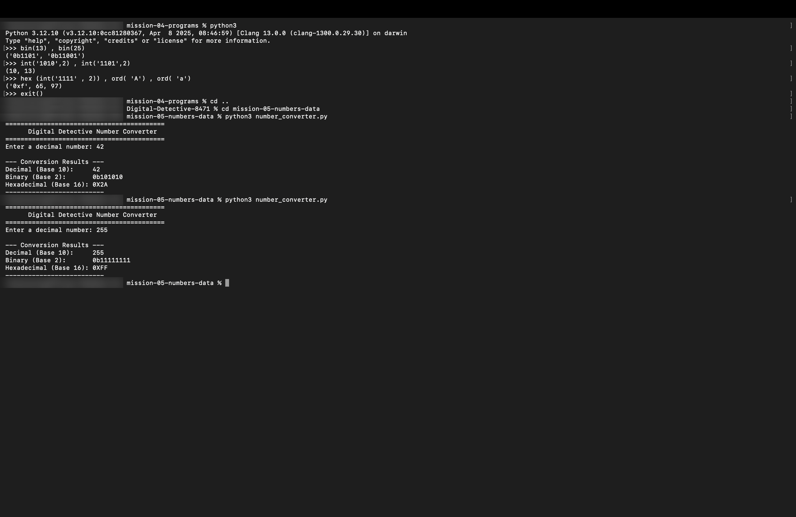

# Mission 5: Numbers, Encodings & Data Representation

## 1. Overview & Mission Objective
- **Assignment**: The Digital Detective — Diwali Independent Learning Assignment
- **Mission**: Mission 5 — Numbers and data
- **Objective**: Master data representation across decimal, binary, and hexadecimal number bases through manual conversions, verify results programmatically using Python's interactive runtime, develop an interactive CLI converter program (`number_converter.py`), and analyze character encoding architectures (ASCII vs. UTF-8).
- **Privacy Standard**: In strict accordance with assignment guidelines, all system paths, logs, and evidence screenshots omit personal usernames, machine serial numbers, and local network identities (`[redacted]` or generic placeholders are used).

---

## 2. Task 5.1 — Convert Numbers by Hand

Computers operate natively on binary bits (base-2), while human communication relies on decimal (base-10), and systems programming utilizes hexadecimal (base-16) for compact byte representation.

### Detailed Step-by-Step Manual Calculations

#### 1. Convert Decimal 13 to Binary
- **Method**: Repeated division by 2, recording the remainders in reverse order (least significant to most significant bit).
  - $13 \div 2 = 6$ remainder **1** (LSB)
  - $6 \div 2 = 3$ remainder **0**
  - $3 \div 2 = 1$ remainder **1**
  - $1 \div 2 = 0$ remainder **1** (MSB)
- **Verification via Positional Expansion**: $(1 \times 2^3) + (1 \times 2^2) + (0 \times 2^1) + (1 \times 2^0) = 8 + 4 + 0 + 1 = 13_{10}$.
- **Result**: **`1101₂`**

---

#### 2. Convert Decimal 25 to Binary
- **Method**: Repeated division by 2:
  - $25 \div 2 = 12$ remainder **1** (LSB)
  - $12 \div 2 = 6$ remainder **0**
  - $6 \div 2 = 3$ remainder **0**
  - $3 \div 2 = 1$ remainder **1**
  - $1 \div 2 = 0$ remainder **1** (MSB)
- **Verification via Positional Expansion**: $(1 \times 2^4) + (1 \times 2^3) + (0 \times 2^2) + (0 \times 2^1) + (1 \times 2^0) = 16 + 8 + 0 + 0 + 1 = 25_{10}$.
- **Result**: **`11001₂`**

---

#### 3. Convert Binary 1010 to Decimal
- **Method**: Sum of positional bit weights ($2^3, 2^2, 2^1, 2^0$):
  - Bit 3 ($2^3 = 8$): $1 \times 8 = 8$
  - Bit 2 ($2^2 = 4$): $0 \times 4 = 0$
  - Bit 1 ($2^1 = 2$): $1 \times 2 = 2$
  - Bit 0 ($2^0 = 1$): $0 \times 1 = 0$
  - Sum: $8 + 0 + 2 + 0 = 10_{10}$
- **Result**: **`10₁₀`**

---

#### 4. Convert Binary 1101 to Decimal
- **Method**: Sum of positional bit weights ($2^3, 2^2, 2^1, 2^0$):
  - Bit 3 ($2^3 = 8$): $1 \times 8 = 8$
  - Bit 2 ($2^2 = 4$): $1 \times 4 = 4$
  - Bit 1 ($2^1 = 2$): $0 \times 2 = 0$
  - Bit 0 ($2^0 = 1$): $1 \times 1 = 1$
  - Sum: $8 + 4 + 0 + 1 = 13_{10}$
- **Result**: **`13₁₀`**

---

#### 5. Convert Hexadecimal A to Decimal
- **Method**: Positional expansion in base-16. In hexadecimal: $A=10, B=11, C=12, D=13, E=14, F=15$.
  - Digit value of $A = 10$
  - Positional weight ($16^0 = 1$): $10 \times 16^0 = 10 \times 1 = 10_{10}$
- **Result**: **`10₁₀`**

---

#### 6. Convert Hexadecimal 1F to Decimal
- **Method**: Positional expansion in base-16 ($16^1, 16^0$):
  - In hexadecimal, $F = 15$.
  - Positional weight 1 ($16^1 = 16$): $1 \times 16 = 16$
  - Positional weight 0 ($16^0 = 1$): $15 \times 1 = 15$
  - Sum: $16 + 15 = 31_{10}$
- **Result**: **`31₁₀`**

---

#### 7. Convert Binary 1111 to Hexadecimal
- **Method**: Grouping 4 binary bits (one nibble) into a single hexadecimal digit:
  - Binary evaluation: $(1 \times 8) + (1 \times 4) + (1 \times 2) + (1 \times 1) = 8 + 4 + 2 + 1 = 15_{10}$.
  - Hexadecimal digit for decimal 15 is **F**.
- **Result**: **`F₁₆`** (or `0xF`)

---

### Manual Conversions Summary Table

| Question | Mathematical Steps & Working | Final Answer |
| :--- | :--- | :--- |
| **Convert decimal 13 to binary** | $13 \div 2 = 6$ R $1$; $6 \div 2 = 3$ R $0$; $3 \div 2 = 1$ R $1$; $1 \div 2 = 0$ R $1$. | **`1101`** |
| **Convert decimal 25 to binary** | $25 \div 2 = 12$ R $1$; $12 \div 2 = 6$ R $0$; $6 \div 2 = 3$ R $0$; $3 \div 2 = 1$ R $1$; $1 \div 2 = 0$ R $1$. | **`11001`** |
| **Convert binary 1010 to decimal** | $(1 \times 8) + (0 \times 4) + (1 \times 2) + (0 \times 1) = 8 + 2 = 10$. | **`10`** |
| **Convert binary 1101 to decimal** | $(1 \times 8) + (1 \times 4) + (0 \times 2) + (1 \times 1) = 8 + 4 + 1 = 13$. | **`13`** |
| **Convert hexadecimal A to decimal** | Value of symbol $A = 10$; $10 \times 16^0 = 10 \times 1 = 10$. | **`10`** |
| **Convert hexadecimal 1F to decimal** | $(1 \times 16^1) + (15 \times 16^0) = 16 + 15 = 31$. | **`31`** |
| **Convert binary 1111 to hexadecimal** | $8 + 4 + 2 + 1 = 15_{10} \implies$ Hex digit is $F$. | **`F`** (`0xF`) |

---

## 3. Task 5.2 — Verify Using Python

The manual calculations were programmatically cross-verified inside the interactive Python 3 REPL environment:

```python
# Decimal to Binary verification
bin(13)         # '0b1101'
bin(25)         # '0b11001'

# Binary to Decimal verification
int('1010', 2)  # 10
int('1101', 2)  # 13

# Hexadecimal to Decimal verification
int('A', 16)    # 10
int('1F', 16)   # 31

# Binary to Hexadecimal verification
hex(int('1111', 2)) # '0xf'
```

### Python Verification Table

| Conversion Task | Python Expression Tested | Python REPL Output | Matches Manual Calculation? |
| :--- | :--- | :--- | :---: |
| **Decimal 13 $\to$ Binary** | `bin(13)` | `'0b1101'` | **Yes** (`1101`) |
| **Decimal 25 $\to$ Binary** | `bin(25)` | `'0b11001'` | **Yes** (`11001`) |
| **Binary 1010 $\to$ Decimal** | `int('1010', 2)` | `10` | **Yes** (`10`) |
| **Binary 1101 $\to$ Decimal** | `int('1101', 2)` | `13` | **Yes** (`13`) |
| **Hexadecimal A $\to$ Decimal** | `int('A', 16)` | `10` | **Yes** (`10`) |
| **Hexadecimal 1F $\to$ Decimal** | `int('1F', 16)` | `31` | **Yes** (`31`) |
| **Binary 1111 $\to$ Hexadecimal** | `hex(int('1111', 2))` | `'0xf'` | **Yes** (`F`) |

---

## 4. Task 5.3 — Build a Small Number Converter (`number_converter.py`)

### Program Implementation
The interactive CLI utility [`number_converter.py`](./number_converter.py) was implemented inside this mission directory:

```python
"""
Number Converter Program - Mission 5 (The Digital Detective)
Converts a user-supplied decimal (base-10) integer into binary (base-2) and hexadecimal (base-16).
"""

def main():
    print("==========================================")
    print("      Digital Detective Number Converter  ")
    print("==========================================")
    
    user_input = input("Enter a decimal number: ").strip()
    
    try:
        decimal_num = int(user_input)
    except ValueError:
        print(f"Error: '{user_input}' is not a valid integer.")
        return

    binary_val = bin(decimal_num)
    hex_val = hex(decimal_num)
    
    print("\n--- Conversion Results ---")
    print(f"Decimal (Base 10):     {decimal_num}")
    print(f"Binary (Base 2):       {binary_val}")
    print(f"Hexadecimal (Base 16): {hex_val.upper()}")
    print("--------------------------")

if __name__ == "__main__":
    main()
```

### Program Test Records
The program was executed and tested across multiple representative integer values:

| Test Number (Decimal) | Command Input | Binary Output (`bin()`) | Hexadecimal Output (`hex()`) | Observation & Significance |
| :---: | :---: | :---: | :---: | :--- |
| **13** | `13` | `0b1101` | `0xD` | Verifies Task 5.1 calculation. |
| **42** | `42` | `0b101010` | `0x2A` | Standard ASCII '*' symbol code. |
| **128** | `128` | `0b10000000` | `0x80` | First value requiring the 8th bit ($2^7$). |
| **255** | `255` | `0b11111111` | `0xFF` | Maximum unsigned 8-bit byte value (all 8 bits set to 1). |

### Explanation of Built-in Conversion Functions:
- **`bin(x)`**: Takes an integer argument `x` and returns its exact binary representation as a string prefixed with `0b`. The prefix denotes to the parser that the following sequence represents base-2 digits.
- **`hex(x)`**: Takes an integer argument `x` and returns its lowercase hexadecimal representation as a string prefixed with `0x`. The prefix indicates that the subsequent characters represent base-16 digits ($0\text{--}9$ and $a\text{--}f$).
- **`int(string, base)`**: Parses a string containing numerical characters according to the specified radix/base ($2$, $10$, or $16$) and produces an internal base-10 integer.

---

## 5. Task 5.4 — How is Text Stored?

### 1. ASCII Decimal Codes for Characters 'A' and 'a':
Using Python's built-in `ord()` function to inspect standard ASCII codepoints:
- **Uppercase `A`**: Decimal **`65`** (Binary: `01000001₂`, Hexadecimal: `0x41`).
- **Lowercase `a`**: Decimal **`97`** (Binary: `01100001₂`, Hexadecimal: `0x61`).
  - *Observation*: Lowercase `a` is exactly $32$ ($2^5$) greater than uppercase `A`. In binary, flipping bit 5 from `0` to `1` instantly converts uppercase letters to lowercase.

### 2. Why Computers Need an Encoding Standard:
Computer hardware (logic gates, silicon transistors, and dynamic memory) can only store and process physical binary electrical states ($0$ and $1$). Because digital hardware possesses no intrinsic concept of human writing systems, alphabets, or punctuation, an **encoding standard** is required to establish a universally recognized lookup table that assigns a unique numeric value (a *code point*) to every individual character, guaranteeing that text written on one computer can be transferred, stored, and displayed on another machine without data corruption or ambiguity.

### 3. Example of a Non-ASCII Character:
Basic 7-bit ASCII is restricted to 128 characters ($0$ to $127$), containing only the English alphabet, Arabic numerals, and standard control symbols. Characters outside basic ASCII include:
- **Euro Currency Symbol**: **`€`** (Unicode Code Point: `U+20AC`).
- **Smiling Face Emoji**: **`😊`** (Unicode Code Point: `U+1F60A`).
- **Devanagari Sacred Syllable**: **`ॐ`** (Unicode Code Point: `U+0950`).

### 4. ASCII vs. UTF-8 Architecture:
- **ASCII (American Standard Code for Information Interchange)**: Uses a fixed 7-bit encoding format ($128$ total characters), sufficient solely for standard English text.
- **UTF-8 (8-bit Unicode Transformation Format)**: A variable-length character encoding standard backward-compatible with 7-bit ASCII (which takes 1 byte), capable of encoding all 1,114,112 Unicode code points using between 1 and 4 bytes per character. This enables global multilingual support, emojis, and scientific notation across the modern web.

---

## 6. Commands and Python Functions Used
- `python3`: Launched the interactive REPL shell for programmatic testing.
- `bin(x)`: Converted integer values into binary strings (`0b...`).
- `hex(x)`: Converted integer values into hexadecimal strings (`0x...`).
- `int(s, base)`: Parsed strings in radix 2 and 16 into Python integer values.
- `ord(c)`: Retrieved the numeric Unicode/ASCII code point of given characters.
- `input()`: Prompted for dynamic user text in the terminal converter.

---

## 7. What Was Understood & Key Reflections
- **Hexadecimal as Human-Readable Binary**: Hexadecimal exists primarily because 4 binary bits map precisely to one hexadecimal digit ($2^4 = 16$). A byte ($8$ bits) can always be written compactly as exactly two hex characters (e.g., `11111111₂` becomes `0xFF`), which simplifies memory address inspection and color representation in software.
- **Case Bit Invariance in ASCII**: The difference between uppercase 'A' (`65 = 01000001₂`) and lowercase 'a' (`97 = 01100001₂`) is exclusively governed by bit 5 ($2^5 = 32$). High-performance compilers leverage this property by bitwise OR-ing with `0x20` to perform rapid case conversions without branch conditions.
- **The Role of Variable-Length Encoding**: UTF-8 efficiently preserves single-byte efficiency for standard ASCII code while expanding to 2, 3, or 4 bytes for international languages and emojis, preventing wasteful memory allocation across software applications.

---

## 8. Difficulties Faced & Solutions
- **Radix Base Conversions**: Converting binary directly to hexadecimal manually can seem intimidating when computing powers of two. The simplest approach was grouping binary digits into 4-bit nibbles starting from the rightmost bit, converting each 4-bit block into its single hex digit counterpart.

---

## 9. Visual Verification Evidence Artifacts

The interactive Python verification session and executions of `number_converter.py` are captured in the privacy-safe terminal record below:

### Evidence: Interactive Python Verification & Number Converter CLI (Tasks 5.2 & 5.3)
Verifying mathematical equivalence in the Python REPL (`bin()`, `int()`, `hex()`, `ord()`) and testing `number_converter.py` across diverse decimal inputs.


