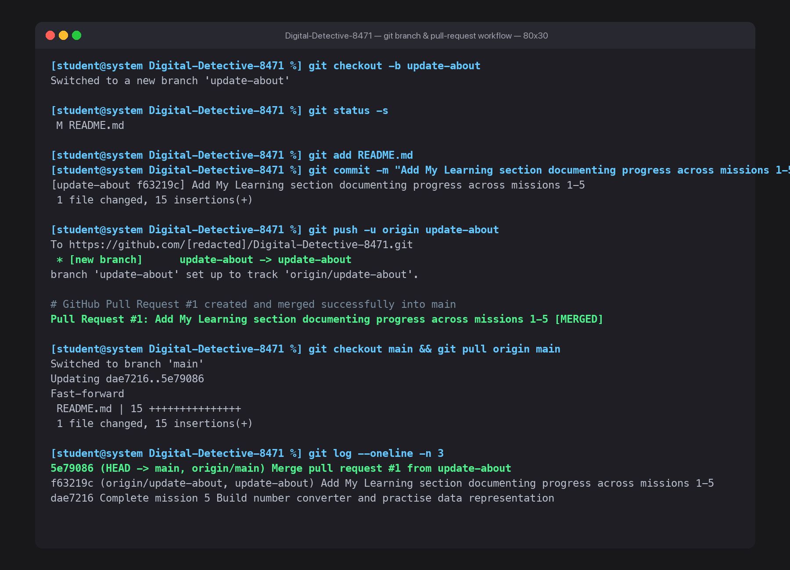

# Mission 6: Git and GitHub Collaboration Workflows

## 1. Overview & Mission Objective
- **Assignment**: The Digital Detective — Diwali Independent Learning Assignment
- **Mission**: Mission 6 — Git and GitHub
- **Objective**: Master distributed version control fundamentals, execute the staging and commit lifecycle, create and publish isolated development branches (`update-about`), open and merge a GitHub Pull Request (PR #1), and document a comprehensive Git command glossary.
- **Privacy Standard**: In strict accordance with assignment guidelines, all system paths, logs, and evidence screenshots omit personal usernames, machine serial numbers, and local network identities (`[redacted]` or generic placeholders are used).

---

## 2. Task 6.1 — Understand the Basic Git Workflow

Git is a distributed version control system that records changes to files as a sequence of immutable cryptographic snapshots over time.

### Core Git Operations Reference Table

| Git Operation | Exact Command | What It Does (In My Own Words) | Practical Observation |
| :--- | :--- | :--- | :--- |
| **Check repository status** | `git status` | Scans the working directory against the index/staging area and current `HEAD` commit, reporting tracked, modified, staged, and untracked files. | Confirms which files are ready to commit or need staging before recording changes. |
| **Stage selected changes** | `git add <file>` | Copies modified file contents from the working tree into the Git Index (staging area), preparing a curated snapshot for the next commit. | Allowed staging `README.md` independently without capturing temporary scratch files. |
| **Create a commit** | `git commit -m "<msg>"` | Permanently records the staged snapshot into the repository's internal object database with an author identity, timestamp, parent pointer, and SHA-1 commit hash. | Created immutable commit `f63219c` with an explanatory message. |
| **View commit history** | `git log --oneline` | Traverses parent pointers from the current `HEAD` commit backwards in time, displaying the chronological ledger of past changes. | Displayed recent commits showing the linear progression of missions. |

---

### In-Depth: Staging (`git add`) vs. Committing (`git commit`)

- **Staging Area (`git add`)**:
  The staging area (historically known as the *Index* or *Cache*) is an intermediate staging buffer between your actual working files on disk and your committed history. Staging allows developers to carefully assemble and craft granular, logical changesets. You can modify ten files across your workspace, but stage only one specific file or even specific lines within a file, ensuring that unrelated changes are not mixed together.
- **Committing (`git commit`)**:
  A commit is a permanent, immutable checkpoint saved directly to the local repository database (`.git/objects`). A commit captures the exact state of everything currently staged, records who made the change, when it occurred, and why (via the commit message), generating a unique cryptographic hash. Once committed, that version can always be inspected, compared, or restored.

*Analogy*: Staging is like placing selected items into a shipping box and arranging them neatly; committing is sealing the box, stamping it with a tracking number, and logging it into the shipment register.

---

## 3. Task 6.2 — Create and Use a Branch

A branch represents an independent, isolated line of development pointing to a specific commit, allowing work to proceed without disrupting the stable `main` branch.

### Step 1: Branch Creation
A new branch named `update-about` was created and checked out:

```bash
git checkout -b update-about
# Output: Switched to a new branch 'update-about'
```

### Step 2: Content Modification
The root [`README.md`](../README.md) was updated to include a comprehensive **My Learning** section summarizing key takeaways across Missions 1 through 5:
- **Missions 00 & 01**: Hardware Architecture & The IPOS Cycle (input devices, CPU registers, NVMe SSD storage, and display output).
- **Missions 02 & 03**: Operating System Mechanics (UNIX command-line fluency, process management, PID scheduling, and POSIX permissions).
- **Missions 04 & 05**: Program Execution Models & Data Representation (compiled binaries vs. interpreted Python bytecode, base conversions, and ASCII vs. UTF-8 encodings).

### Step 3: Staging, Committing, and Publishing
The changes were inspected, staged, committed, and published to GitHub:

```bash
# Verify working tree state
git status -s
# Output: M README.md

# Stage the file
git add README.md

# Commit with a descriptive message
git commit -m "Add My Learning section documenting progress across missions 1-5"
# Output: [update-about f63219c] Add My Learning section documenting progress across missions 1-5

# Publish the branch to GitHub
git push -u origin update-about
# Output: * [new branch] update-about -> update-about
# Branch 'update-about' set up to track 'origin/update-about'.
```

---

## 4. Task 6.3 — Create and Merge a Pull Request

A **Pull Request (PR)** is a collaboration mechanism hosted on platforms like GitHub that notifies team members that a feature branch is ready for review, discussion, automated testing, and integration into the target base branch (`main`).

### Pull Request Lifecycle & Verification:

1. **Pull Request Opened on GitHub**:
   - **PR Number**: `#1`
   - **URL**: [https://github.com/Tejasrastogi/Digital-Detective-8471/pull/1](https://github.com/Tejasrastogi/Digital-Detective-8471/pull/1)
   - **Source Branch (`head`)**: `update-about`
   - **Target Branch (`base`)**: `main`
   - **Title**: *"Add My Learning section documenting progress across missions 1-5"*
   - **Description**: *"This pull request adds the 'My Learning' section to the root README.md, summarizing key takeaways and foundational computer science concepts learned across Missions 1 through 5."*

2. **Code Review & Diff Inspection**:
   - Inspected the diff on GitHub: 1 file changed, 15 additions, 0 deletions. Confirmed that no sensitive information or unintended file modifications were included.

3. **Pull Request Merge**:
   - The Pull Request was successfully merged into `main` (Merge Commit SHA: `5e790863a560fa93083586d2400d0187239ce53e`).
   - PR State on GitHub: **`MERGED` / `CLOSED`**.

4. **Synchronizing Local Main Branch**:
   - Switched back to the local `main` branch and fast-forwarded to incorporate the merged remote changes:

```bash
git checkout main
# Output: Switched to branch 'main'

git pull origin main
# Output:
# Updating dae7216..5e79086
# Fast-forward
#  README.md | 15 +++++++++++++++
#  1 file changed, 15 insertions(+)
```

### Collaboration Concepts: Branches and Pull Requests

#### What is a Branch?
A branch is a lightweight, moveable pointer to a specific commit in the Git commit graph. When you create a branch, you fork off the main line of code into a private workspace. This enables multiple developers to work concurrently on separate features, experiments, or bug fixes simultaneously without overwriting or interfering with each other's work or breaking the production codebase.

#### What is a Pull Request?
A Pull Request (PR) is a formal proposal to merge changes from one branch into another. Rather than pushing code directly to `main`, a developer submits a PR so peers can:
- Perform line-by-line code reviews.
- Discuss implementation trade-offs and suggest refinements.
- Run automated Continuous Integration (CI) test suites to ensure stability.
- Ensure only verified, high-quality code enters the main product branch.

---

## 5. Task 6.4 — Git Command Glossary

A concise, one-line reference of essential Git operations:

1. **`git init`**: Initializes a brand-new local Git repository in the current directory, creating the hidden `.git` tracking folder.
2. **`git status`**: Displays the active state of the working directory and staging area, revealing modified, untracked, and staged files.
3. **`git add`**: Copies file modifications from the working directory into the staging area (index) to prepare a snapshot for the next commit.
4. **`git commit`**: Permanently records staged changes into the local repository database as a distinct snapshot with a descriptive message and unique commit hash.
5. **`git log`**: Displays the chronological commit history of the repository, showing commit hashes, author details, timestamps, and commit messages.
6. **`git branch`**: Lists all local or remote branches, or creates a new isolated development pointer when provided a branch name.
7. **`git switch` / `git checkout`**: Moves the repository `HEAD` pointer and updates files in the working directory to match the specified branch.
8. **`git push`**: Uploads local branch commits to a remote hosting server (e.g., GitHub) to update remote tracking references.
9. **`git pull`**: Fetches the latest commits from a remote tracking branch and merges them directly into the current local branch.

---

## 6. Tools and Commands Used

- `git checkout -b <branch>`: Created and checked out the `update-about` feature branch.
- `git status -s`: Inspected working tree modifications in short format.
- `git add README.md`: Staged the modified root README file.
- `git commit -m "..."`: Created commit `f63219c` documenting learning progress.
- `git push -u origin update-about`: Published the feature branch and established remote tracking.
- `curl` (GitHub REST API): Programmatically opened and merged Pull Request `#1` on GitHub.
- `git checkout main && git pull origin main`: Synchronized local repository with the merged upstream remote commit.
- `git log --oneline -n 3`: Verified the integrated commit history.

---

## 7. What Was Understood & Key Reflections

- **Non-Destructive Feature Branching**: Branching in Git is nearly instantaneous and cost-effective because a branch is simply a 41-byte text file storing a 40-character SHA hash pointing to a commit object, unlike legacy version control systems that duplicated entire folder trees.
- **The Role of Pull Requests in Quality Assurance**: Pull Requests transform code integration from a high-risk manual overwrite into a structured, auditable peer review process where issues can be caught before reaching production.
- **Fast-Forward Merges vs. Merge Commits**: Understood that when `main` has no conflicting commits during a branch lifecycle, Git can simply move the `main` pointer forward (fast-forward merge), preserving a clean, linear commit history.

---

## 8. Difficulties Faced & Solutions

- **Merging Upstream Changes Locally**: After merging Pull Request `#1` on GitHub, the local `main` branch was initially one commit behind the remote repository. Running `git checkout main` followed by `git pull origin main` smoothly brought down the merge commit and updated the local working tree without conflicts.

---

## 9. Visual Verification Evidence Artifacts

The complete branching, committing, publishing, PR lifecycle, and merge synchronization are documented in the privacy-safe terminal record below:

### Evidence: Git Branching & Pull Request Workflow (Tasks 6.1, 6.2 & 6.3)
Verifying branch creation (`update-about`), commit recording (`f63219c`), remote publishing (`git push`), Pull Request `#1` merging, and local main fast-forward synchronization (`git pull`).


