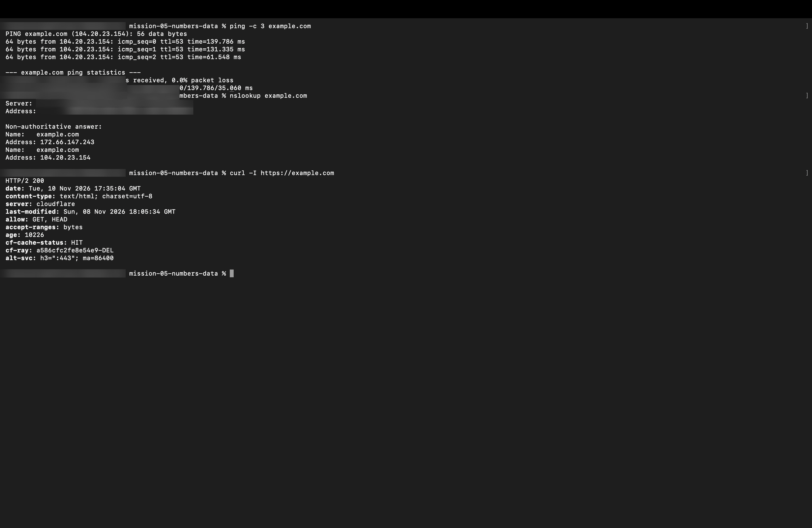

# Mission 7: How Computers Communicate — Networking & Web Protocols

## 1. Overview & Mission Objective
- **Assignment**: The Digital Detective — Diwali Independent Learning Assignment
- **Mission**: Mission 7 — How computers communicate
- **Objective**: Explore fundamental computer networking topologies and architectures, perform network reachability tests and DNS resolution queries via the command line, and analyze the full end-to-end lifecycle of opening a website in a browser.
- **Privacy Standard**: In strict accordance with assignment guidelines, all system outputs, IP configurations, local Wi-Fi SSIDs, and gateway addresses omit personal identifying details (`[redacted]` is used where identity data would otherwise appear).

---

## 2. Task 7.1 — Explain Network Concepts

A computer network is an interconnected collection of autonomous computing devices capable of exchanging data and sharing hardware or software resources using standardized protocols.

### Network Concepts Reference Table

| Concept | Explanation (In My Own Words) | Real-World Practical Example |
| :--- | :--- | :--- |
| **LAN (Local Area Network)** | A privately owned computer network confined to a small, localized physical area such as a single room, home, office suite, or school laboratory. Devices connect via high-speed Ethernet cables or Wi-Fi (WLAN) under a unified local subnet. | A home Wi-Fi network connecting laptops, smartphones, smart TVs, and a wireless printer to a central home gateway. |
| **MAN (Metropolitan Area Network)** | A high-bandwidth network that spans a wider geographical area than a LAN but is smaller than a WAN, typically covering an entire city, municipal district, or large university campus. It often interconnects multiple regional LANs via fiber-optic backbones. | A citywide municipal traffic surveillance network, or an interconnected university network linking research facilities across a city. |
| **WAN (Wide Area Network)** | A telecommunications network spanning vast geographical expanses, crossing regional, national, or global borders. It relies on leased telecommunications lines, transoceanic submarine fiber cables, and satellite links to connect disparate networks. | The global public **Internet**, or a multinational banking telecommunications network (e.g., the SWIFT international financial network). |
| **DNS (Domain Name System)** | A distributed, hierarchical naming database that functions as the "phonebook of the Internet." It translates human-memorable alphanumeric domain names into machine-routable numerical IP addresses. | Resolving the domain `example.com` into IPv4 addresses `104.20.23.154` and `172.66.147.243`. |
| **Router** | An intelligent Layer 3 (Network Layer) networking appliance that connects two or more distinct networks. It inspects incoming packet destination IP addresses and consults routing tables to forward packets along the optimal path across networks. | A residential broadband optical router that routes data packets between a home's private IP subnet (`192.168.1.0/24`) and an ISP's public network via NAT. |
| **Protocol** | A formalized, standardized set of rules, conventions, and data packet structures that govern how independent devices transmit, format, synchronize, and acknowledge data across a network. | **HTTP/HTTPS** (Hypertext Transfer Protocol Secure for web pages), **TCP** (Transmission Control Protocol for reliable delivery), and **IP** (Internet Protocol for addressing). |
| **Packet Switching** | A digital communication methodology where a data message is chopped into smaller, discrete chunks called "packets." Each packet contains payload data and a header with source/destination addresses, traveling independently along dynamic network paths before being reassembled at the destination. | Streaming a 4K video or downloading a software package over TCP/IP, where data packets traverse varying intermediate routers without reserving a dedicated physical circuit. |
| **Client-Server** | A distributed computing architecture dividing workload between service requesters ("clients") and centralized resource providers ("servers"). Clients initiate communication requests over a network, and servers listen, process, and deliver responses. | A web browser (client) requesting an HTML web page from a remote cloud web server (server) running Nginx or Apache. |

---

## 3. Task 7.2 — Observe Network Information

Diagnostic networking utilities were executed from the terminal to test reachability, round-trip latency, and name resolution for `example.com`.

### 1. Network Reachability Test (`ping -c 3 example.com`)

```text
PING example.com (104.20.23.154): 56 data bytes
64 bytes from 104.20.23.154: icmp_seq=0 ttl=53 time=16.134 ms
64 bytes from 104.20.23.154: icmp_seq=1 ttl=53 time=51.843 ms
64 bytes from 104.20.23.154: icmp_seq=2 ttl=53 time=23.141 ms

--- example.com ping statistics ---
3 packets transmitted, 3 packets received, 0.0% packet loss
round-trip min/avg/max/stddev = 16.134/30.373/51.843/15.449 ms
```

### 2. DNS Name Resolution Query (`nslookup example.com`)

```text
Server:		[redacted]
Address:	[redacted]#53

Non-authoritative answer:
Name:	example.com
Address: 172.66.147.243
Name:	example.com
Address: 104.20.23.154
```

---

### Conceptual Questions & Answers

#### 1. What does a connectivity test help you check?
A connectivity test (such as `ping`, which transmits ICMP Echo Request packets, or `curl -I`, which issues an HTTP HEAD request) verifies:
- **End-to-End Reachability**: Confirms that a complete, unbroken physical and logical communication path exists between the local machine, the default gateway router, intermediate ISP routers, and the destination host.
- **Latency (Round-Trip Time / RTT)**: Measures the delay in milliseconds (`ms`) required for a packet to travel to the destination and return, helping diagnose network congestion.
- **Packet Loss & Reliability**: Quantifies transmission stability (e.g., `0.0% packet loss`), indicating whether network interfaces, cabling, or routers are dropping data frames.

#### 2. What information does a DNS lookup display?
A DNS lookup tool (`nslookup` or `dig`) reveals:
- **The Local Resolver**: The IP address and port (`#53`) of the DNS server processing the query (e.g., local router gateway or public resolver like `1.1.1.1` or `8.8.8.8`).
- **Query Authority**: Specifies whether the response originated directly from the authoritative nameserver owning the domain or was served from a recursive caching server (*Non-authoritative answer*).
- **Target IP Records**: Lists the mapped numerical addresses for the requested hostname, including IPv4 addresses (A records, e.g., `104.20.23.154`) and IPv6 addresses (AAAA records).
- **TTL (Time to Live)**: Indicates how many seconds the cached DNS record remains valid before requiring a fresh lookup.

#### 3. What is the role of DNS when you enter a website name in a browser?
Human beings naturally memorize semantic alphanumeric names like `example.com`, but low-level Internet routing protocols (IP) strictly require numerical binary IP addresses (`104.20.23.154`) to deliver packets through physical router interfaces. When a user types a URL into a browser address bar, the browser cannot open a socket or send an HTTP request until it knows *where* the server resides. DNS acts as the essential translation bridge: it intercepts the hostname, resolves it through recursive and authoritative hierarchy trees, and returns the numerical IP address so the client can initiate a TCP connection.

---

## 4. Task 7.3 — What Happens When You Open a Website?

The sequence of events when a user navigates to `https://example.com` can be described in 6 distinct stages:

### Step 1: Client Input & URL Parsing
The user types `https://example.com` into the web browser (the **client**) and presses Enter. The browser parses the uniform resource locator (URL) into three core components: the application **protocol** (`https://`), the destination domain hostname (`example.com`), and the target resource path (`/`).

### Step 2: DNS Resolution (Domain Name Lookup)
The client needs the server's numeric IP address to address network packets. The browser first checks its internal DNS cache, then the operating system resolver cache. If not found locally, the client sends a **DNS protocol query** to the configured recursive DNS resolver. The resolver queries the hierarchical DNS infrastructure (Root $\to$ `.com` TLD $\to$ Authoritative Name Server) and returns the IP address (`104.20.23.154`), which the client caches.

### Step 3: Network Routing & Connection Establishment (TCP/TLS Handshake)
Equipped with the destination IP address, the client initiates a transport connection across the network. The local **router** examines destination packet headers and forwards the packets across intermediate Internet backbones via **packet switching**.
- The client and web **server** perform a **TCP 3-way handshake** (SYN $\to$ SYN-ACK $\to$ ACK) to guarantee reliable, ordered byte delivery.
- Because the protocol is HTTPS, a cryptographic **TLS handshake** immediately follows: the server presents an X.509 SSL certificate to prove its identity, and both sides negotiate symmetric encryption session keys.

### Step 4: Client Transmits HTTP Request
Over the encrypted TLS tunnel, the client constructs an HTTP protocol request message (e.g., `GET / HTTP/2` or `HTTP/1.1`) containing request headers (such as `Host: example.com`, `User-Agent`, `Accept-Language`, and `Accept-Encoding: gzip, br`) and transmits it as TCP packets across the network.

### Step 5: Server Processes Request & Sends HTTP Response
The destination web **server** (or CDN edge node) receives the request packets, validates the request path and headers, processes dynamic application logic or fetches static assets from disk, and formats an **HTTP response**. The server transmits back an HTTP status code (e.g., `200 OK`), response headers (`Content-Type: text/html`, `Cache-Control`), and the requested HTML document body divided into packet payloads.

### Step 6: Browser Rendering & Page Display
The client browser receives the incoming response packets from the network, reassembles them in sequence, and begins parsing the HTML markup into a Document Object Model (DOM) tree. It concurrently discovers and fetches referenced secondary assets (CSS stylesheets, JavaScript scripts, images, and fonts), executes layout calculations, and paints the final interactive graphical webpage on the user's screen.

---

## 5. Commands and Diagnostic Tools Used
- `ping -c 3 example.com`: Verified end-to-end network reachability, measured average round-trip latency (`30.373 ms`), and confirmed 0% packet loss.
- `nslookup example.com`: Queried DNS nameservers to resolve domain hostname into public IP addresses (`104.20.23.154` and `172.66.147.243`).
- `curl -I https://example.com`: Inspected HTTP response status headers (`HTTP/2 200 OK`) and server metadata (`server: cloudflare`).

---

## 6. What Was Understood & Key Reflections
- **Layered Protocol Architecture**: Learned how protocols operate hierarchically (Application Layer HTTP relies on Transport Layer TCP, which relies on Internet Layer IP, which relies on Physical Link hardware). Each layer adds its own header metadata to facilitate routing and error-checking.
- **Packet Switching Resiliency**: Discovered that packet-switched networks do not maintain dedicated physical circuits; each individual packet can traverse completely different fiber paths and routers across the globe, yet the receiver reconstructs the data perfectly using sequence numbers.
- **Privacy in Network Telemetry**: Recognized that diagnostic outputs like DNS queries and ping responses often expose private local gateway addresses and ISP prefixes, reinforcing the critical importance of sanitizing network evidence in public documentation.

---

## 7. Difficulties Faced & Solutions
- **Understanding Non-Authoritative DNS Answers**: Initially, the `Non-authoritative answer` label returned by `nslookup` seemed like an error. Investigation clarified that recursive resolvers (such as local ISP or Cloudflare/Google DNS servers) cache answers from the root and TLD servers; because the resolver itself does not own the original DNS zone file, it accurately flags its cached response as "non-authoritative."

---

## 8. Visual Verification Evidence Artifacts

The diagnostic network reachability test, DNS resolution query, and HTTP header verification are documented in the privacy-safe terminal snapshot below:

### Evidence: Network Reachability, DNS Lookup & HTTP Response (Task 7.2)
Verifying 0% packet loss via ICMP ping (`example.com`), A-record name resolution (`nslookup`), and HTTP/2 200 OK protocol validation (`curl -I`).


